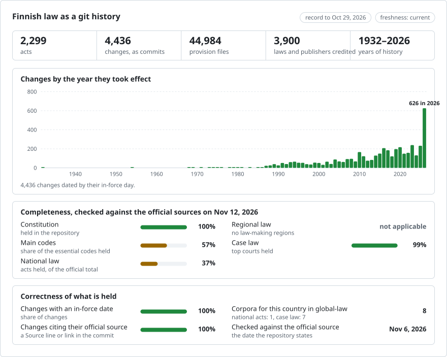

# Finland: law history in git

**English** · **[Tai lue suomeksi](README.md)**

<picture>
<source media="(prefers-color-scheme: dark)" srcset="data/effort-dark.svg">

</picture>

The law of Finland as a git history: one file per section (pykälä), one commit per version on the day it took effect, and the act that made each change as the commit's author. `git blame` names the act behind every line; `git log` lists every change to a section; picking a date gives the text in force that day.

Part of [lexifina/global-law](https://github.com/lexifina/global-law), one git history for every country's law: this is Finland's national law, which global-law reads at `finland/national/acts/`.

**What is in it now:** the Constitution and 2,290 other acts in force (lait), of the 6,239 that Finlex consolidates, with 4,436 versions: 1,749 rebuilt from the original statute by applying each amending act in turn, with the end state checked against Finlex's current consolidation, and 542 held as that consolidation only ([`CURRENT-TEXT.md`](CURRENT-TEXT.md)). [`acts.csv`](acts.csv) lists every act here with its folder, [`amendments.csv`](amendments.csv) every amending act with its dates, and [`LEFT-OUT.csv`](LEFT-OUT.csv) the 3,941 acts in force left out, with the reason for each.

Each act is in `laki/<year>/<number>/`, one file per section (`pykala-NNN.md`, or `luku-NN-pykala-NNN.md` where sections are numbered per chapter): `laki/2019/872/` is the Työaikalaki, the Working Hours Act, 872/2019, and the Constitution, Suomen perustuslaki 731/1999, is [`laki/1999/731/`](laki/1999/731/). Until 10 November 2026 each folder was named by the act's id (`tyoaikalaki`, `perustuslaki`, `sd-<year>-<number>`), as the earlier history and `tools/finlex.py` still name it; [`data/paths.json`](data/paths.json) maps each id to its folder.

The text is in Finnish, as Finlex publishes it. The Swedish text, equally official, and translations are not part of this record.

## Questions as git commands

| Question | Command |
| --- | --- |
| Every change to 34 § of the Working Hours Act | `git log -p --word-diff --follow -- laki/2019/872/pykala-034.md` |
| Which act wrote each line of 34 §? | `git blame laki/2019/872/pykala-034.md` |
| Every version of the Working Hours Act, with the day each took effect | `git log --format="%h %(trailers:key=In-force,valueonly,separator=) %an" -- laki/2019/872 tyoaikalaki` |
| 34 § as in force on 1 January 2022 | `python tools/finlex.py 2022-01-01 tyoaikalaki 34` |

**Outside git**, we also host this record publicly, for free:

- **[Ask Claude about Finnish law](https://global-law.lexifina.com/v1/try_claude?country=finland)**: opens Claude with a first question ready.
- **[Ask ChatGPT](https://global-law.lexifina.com/v1/try_chatgpt?country=finland)**: the same question in ChatGPT.
- **[Call the API in your browser](https://global-law.lexifina.com/v1/search_law?query=vuosiloma&jurisdictions=finland)**: a search of Finnish law for "vuosiloma", returned as JSON. See the [documentation here](https://lexifina.com/api/global-law).

Both assistants read the record through the free Global law connector (MCP, `https://global-law.lexifina.com/mcp`); the first time, the chat gives you the link that adds it. Ask in Finnish or in English.

**Host it yourself easily.** All it takes is git and Python, and the tools run on your machine:

```sh
git clone --depth 1 https://github.com/lexifina/global-law && cd global-law
python3 tools/countries.py add finland/national/acts
python3 tools/law.py show 2026-01-01 finland/national/acts/laki/2019/872/pykala-034.md
```

Opened in Claude Code, Cursor, VS Code or Codex, the clone also starts a local MCP server with the same tools ([MCP.md](https://github.com/lexifina/global-law/blob/main/MCP.md)).

## Dates

Each commit is dated at noon, Europe/Helsinki, on the day the version took effect, and carries it in its `In-force:` trailer:

- for a rebuilt act, the in-force day Finlex gives for the original and for each amending act (its `amendedBy` list); where Finlex gives none, from the act's own commencement sentence when it names one fixed day, Finlex's editorial note, or, for an act brought into force by decree, that decree. A temporary amendment carries `Expires:`, and the day after it a second commit by the same act restores the earlier text;
- for a current-text act, the day its newest wording took effect: the in-force day Finlex gives for the latest amending act it lists, or the act's own. The 38 for which Finlex gives no day are dated the day the text was retrieved, 2026-10-28; `In-force-basis:` says which rule gave the day;
- git cannot store dates before 1970, so the 5 earlier commits (from 1932) are dated 1970-01-01, with the real day in `In-force:`.

Each change is credited to the act that made it (`944/2024`, address `sd-2024-944@finlex.invalid`). A current-text act's one commit is credited to `Finlex (Oikeusministeriö)`, or to the act itself where Finlex lists no amending act for it. Changes due after the build day are on the `future` branch, never merged.

## How it is checked

- `tools/build.py scan` commits an act only if its rebuilt end state equals Finlex's current consolidation in every section, after the normalisation [`REPRODUCE.md`](REPRODUCE.md) declares; acts that fail are left out.
- `tools/check_repo.py` reads every act back from git: its last version must equal the consolidation and its first the original statute. `tools/check_words.py` compares the letters and digits of every last version with the consolidation's XML, through a separate extractor.
- For a current-text act, every word of the consolidation must be in its files, in order, and nothing else, read back from git (`tools/current_text.py`).
- `tools/test_repo.py` checks that blame, the dated tool and commands like those above work. The results are in [`REPRODUCE.md`](REPRODUCE.md).

## What it does not show

- **Official earlier versions.** Finlex publishes only each act's current consolidation: the earlier versions of the rebuilt acts are replayed from the amending acts and not checked against an official text, and the 542 current-text acts have no earlier versions here.
- **3,941 acts in force**: 3,231 have no text in Finlex's open data, 389 are amending acts listed as in force, and the rest could not be rebuilt and verified (see [`LEFT-OUT.csv`](LEFT-OUT.csv)).
- **Decrees (asetukset), acts no longer in force, case law and bills.**
- **Fixed commit hashes.** A rebuild that adds acts may re-date the history, so hashes and tags may change.

## Sources

| Source | Kind | Past versions | Notes |
| --- | --- | --- | --- |
| [Finlex](https://www.finlex.fi) open data (Oikeusministeriö), Akoma Ntoso | Official database: original statutes of the Suomen säädöskokoelma and current consolidations | no, the current consolidation only | Only the Statute Book (Suomen säädöskokoelma) is authoritative; Finlex's consolidations are for information |

Finlex's API behaviour was learned from [LawVM](https://github.com/eliask/lawvm) and [legalize-dev](https://github.com/legalize-dev); no code was copied.

## Licence

See [`LICENSE`](LICENSE). Finlex open data is licensed under CC BY 4.0, with Finlex's conditions on personal data; the rebuilt earlier versions are derived from it and are not published by Finlex. The history, commit messages, tables and tools are CC0 1.0.

No model wrote legal text or ran at build time; the code was written with Claude, an AI model (see [`REPRODUCE.md`](REPRODUCE.md)).

## More

From [lexifina/global-law](https://github.com/lexifina/global-law):

- [FEATURES.md](https://github.com/lexifina/global-law/blob/main/FEATURES.md): every feature, and what every corpus must support (`git blame`, `law.py`, the MCP tools)
- [FAQ.md](https://github.com/lexifina/global-law/blob/main/FAQ.md): questions and answers · [CONTRIBUTING.md](https://github.com/lexifina/global-law/blob/main/CONTRIBUTING.md): proposing changes · [MCP.md](https://github.com/lexifina/global-law/blob/main/MCP.md): the MCP server · [REPRODUCE.md](https://github.com/lexifina/global-law/blob/main/REPRODUCE.md): how it was built · [CHANGELOG.md](https://github.com/lexifina/global-law/blob/main/CHANGELOG.md)
- [FRESHNESS.md](https://github.com/lexifina/global-law/blob/main/FRESHNESS.md): how current each corpus is · [Monitoring](https://github.com/lexifina/global-law/tree/main/monitoring): whether updates are running · [WATCHING.md](https://github.com/lexifina/global-law/blob/main/WATCHING.md): how each official source is watched for changes
- [performance/](https://github.com/lexifina/global-law/tree/main/performance): how fast the tools are, measured
- [visualisations/](https://github.com/lexifina/global-law/tree/main/visualisations): charts and bridges across the world's law
- [Vulnerabilities](https://github.com/lexifina/global-law/tree/main/vulnerabilities): mistakes in legislation as published
