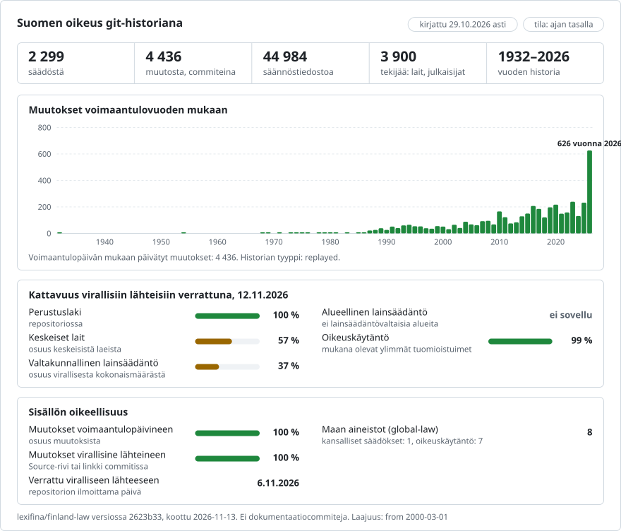

# Suomen lainsäädäntö muutos muutokselta

**Suomi** · [English](README.en.md)

<picture>
<source media="(prefers-color-scheme: dark)" srcset="data/fi/effort-dark.svg">

</picture>

Osa [lexifina/global-law](https://github.com/lexifina/global-law)-kokonaisuutta, joka on yksi git-historia jokaisen maan oikeudelle: tämä on Suomen kansallinen lainsäädäntö, jonka global-law lukee polusta `finland/national/acts/`.

1 757 voimassa olevaa Suomen lakia git-repositoriona: perustuslaki (Suomen perustuslaki, 731/1999) ja jokainen muu
Finlexin ajantasaistama laki, jonka historian toisto pystyy muodostamaan. Jokainen muutossäädös on yksi commit, joka
merkitään kyseisen säädöksen nimiin ja päivätään sen voimaantulopäivälle kello 12 Helsingin aikaa. Teksti on suomenkielinen.

**Tämä aineisto on osittainen.** Siinä on ne 1 757 lakia, joiden toisto täsmää, 6 239 voimassa olevasta laista;
myöhemmät uudelleenkoostamiset lisäävät lakeja ja päivittävät historian päivämäärät, joten commit-tunnisteet (hashit)
ja tagit voivat muuttua.

**Välivaiheen versiot on muodostettu toistamalla. Vain kunkin lain lopputila tarkistetaan virallista ajantasaista versiota vasten.**
Finlex tarjoaa säädöksestä vain NYKYISEN ajantasaisen version. Tämän repositorion välivaiheen versiot on siksi TOISTETTU: alkuperäinen säädös otetaan Suomen säädöskokoelmasta, ja kukin muutossäädös sovelletaan voimaantulojärjestyksessä niin kuin säädöksen oma johtolause määrää (kokonaiset pykälät, otsikot, väliotsikot, momentit, johdantokappaleet, kohdat ja luvut; muuttaminen, lisääminen ja kumoaminen; määräaikaiset muutokset päättyvät viimeistä voimassaolopäivää seuraavana päivänä). Vain kunkin lain lopputila tarkistetaan virallista ajantasaista versiota vasten; aiempia versioita ei ole vahvistettu erikseen. Menetelmä on sama kuin US Code -repositoriossa: toisto ja sen jälkeen tuloksen vertaaminen viralliseen tekstiin.

| | |
| --- | --- |
| Voimassa olevat lait, jotka Finlex ajantasaistaa | 6 239 |
| Lakeja täällä | 1 757 (535 muutettua, lopputila tarkistettu ajantasaista versiota vasten; 1 222 koskaan muuttamatonta, joista 796:n ajantasaisessa versiossa ei ole tekstiä, joten alkuperäistä ei verrata siihen) |
| Pois jätetyt lait | 4 482 ([`LEFT-OUT.csv`](LEFT-OUT.csv)) |
| Muutoscommitit `main`-haarassa | 2 145 (joista 4 on määräaikaisten muutosten päättymisiä) |
| Commitit `future`-haarassa, jota ei koskaan yhdistetä | 34 |
| Ensimmäinen voimaantulopäivä | 1954-01-01 |

## Kysymykset git-komentoina

| Kysymys | Komento |
| --- | --- |
| Mitä perustuslain 10 § sanoi 1.1.2015? | `python tools/finlex.py 2015-01-01 perustuslaki 10` |
| Koko perustuslaki sellaisena kuin se oli vuonna 2010 | `python tools/finlex.py 2010-01-01 perustuslaki` |
| Mikä säädös kirjoitti 10 §:n kunkin rivin? | `git blame perustuslaki/pykala-010.md` |
| Jokainen 10 §:n muutos säädöksineen ja päivineen | `git log --follow perustuslaki/pykala-010.md` |
| Kaikki, mitä yksi säädös muutti | `git show --stat perustuslaki/2011-1112` |
| Missä kansiossa laki on | [`acts.csv`](acts.csv) (säädösnumero, kansio, nimike) |
| Muutossäädökset kaikkine päivämäärineen | [`amendments.csv`](amendments.csv) |
| Kaikki, mikä tuli voimaan 1.1.2020 | `git log --grep="^In-force: 2020-01-01" --format="%an %s"` |
| Jokaisen lain historia, yksi tagi kutakin lakia ja muutosta kohden | `git tag --list "perustuslaki/*"` |

## Päivämäärät ja mitä niistä käytetään

Suomen lailla on antamispäivä (`Enacted:`, allekirjoituspäivä), päivä, jona se julkaistiin Suomen säädöskokoelmassa
(`Published:`), ja voimaantulopäivä (`In-force:`). **Commitit päivätään sille päivälle, jona muutos tuli voimaan**,
kello 12 Helsingin aikaa (EET, kesäaikana vuodesta 1981 EEST). Jokaisella tämän repositorion muutossäädöksellä on yksi
voimaantulopäivä, joka luetaan Finlexin `amendedBy`-luettelosta; vaiheittain voimaan tulevat säädökset on jätetty pois.
Määräaikaisessa muutoksessa on `Expires:`; sitä seuraavana päivänä saman säädöksen toinen commit palauttaa aiemman
tekstin. Muutokset, jotka tulevat voimaan koostamispäivän jälkeen, ovat `future`-haarassa, jota ei koskaan yhdistetä.
Vuotta 1970 edeltävät päivät asetetaan gitissä päivälle 1970-01-01 (sekuntien välein, järjestyksessä); `In-force:`
sisältää todellisen päivän.

## Mitä ”tekijä” (author) tarkoittaa

Commitin tekijä (author) on muutoksen tehnyt säädös (`817/2018`, osoite `sd-2018-817@finlex.invalid`), joten `git blame`
nimeää säädöksen. Commitin tallentaja (committer) on aina `Lexifina`.

## Miten se tarkistetaan

`tools/build.py scan` toistaa jokaisen lain ja pysäyttää sen, ellei toistettu lopputila vastaa virallista ajantasaista versiota jokaisen pykälän osalta seuraavan normalisoinnin jälkeen: (1) otsikon lopussa oleva muutosmerkintä, kuten ” (4.11.2011/1112)”, poistetaan (Finlex lisää sen ajantasaiseen versioon); (2) U+2015 ja U+2014 (viivat) luetaan merkiksi U+2013; (3) alkuperäisen tekstin rivinvaihtotavuviiva sanassa ”valtio-neuvoston” (731/1999 131 §) luetaan muodossa ”valtioneuvoston”, kuten ajantasainen versio sen painaa; (4) lukuriviä ei verrata pykälissä, jotka alkuperäinen teksti painaa minkään luvun ulkopuolelle (esim. 731/1999:n 130 § ja 131 §, jotka ajantasainen versio sijoittaa 13 lukuun); (5) Finlexin toimitukselliset huomautukset ajantasaisessa versiossa (noteAuthorial) eivät ole osa tekstiä eikä niitä verrata, eikä myöskään joidenkin alkuperäisten tekstien oikaisuhuomautuksia (authorialNote, ”Merkitty kohta oikaistu ...”, jotka antavat sanamuodon ennen julkaistua oikaisua; oikaistu sanamuoto on teksti); (6) Finlexin kumoamismerkinnät ajantasaisessa versiossa (”3 momentti on kumottu L:lla 29.8.2008/562.”, ”4 § on kumottu L:lla ...”) ovat toimituksellisia huomautuksia eivätkä tekstiä: toisto poistaa itse säännöksen (kumottu momentti säilyttää paikkansa, joten myöhemmät momentit säilyttävät numeronsa); (7) otsikon loppupistettä, jonka vanhemmat alkuperäiset tekstit painavat (”Lain soveltamisala.”) ja ajantasainen versio jättää pois, ei verrata, ja vanhemmassa alkuperäisessä tekstissä pelkkänä painettu luvun numero (”1”) luetaan niin kuin ajantasainen versio sen painaa (”1 luku”); (8) välilyöntejä pykälämerkin edessä (”3§” vanhemmissa alkuperäisissä teksteissä, ”3 §” ajantasaisessa versiossa) ja sen jälkeen (”57 §: n”, ”57 §:n”) ei verrata; (9) kahden luvun välinen yhdysmerkki (”3-5 §”) luetaan ajatusviivaksi, jonka ajantasainen versio painaa (”3–5 §”); (10) Finlexin rivin sisäiset muutosmerkinnät (”oloista: (10.8.2018/678)”) poistetaan, kuten otsikoissa; (11) sanan sisäistä tavuviivaa, jonka perässä on tai ei ole välilyöntiä, ei verrata: toiseen lähteeseen jäänyt rivinvaihtotavutus (”rautatieyrityk-sellä”, ”toimeksi- antosopimus”, ”ar-vioidusta”); (12) sitä, miten pykälän rivit jakautuvat momentteihin, ei verrata (jotkin tekstit painavat kaksi momenttia yhtenä momenttina, jossa on kaksi kappaletta, tai yhden momentin kahtena); itse rivit ja niiden järjestys verrataan. Vain tarkistuksen läpäisseet lait tallennetaan commiteiksi.
`tools/check_repo.py` lukee sen jälkeen jokaisen lain versiot takaisin gitistä ja vertaa viimeistä ajantasaiseen
versioon ja ensimmäistä alkuperäiseen säädökseen; `tools/check_words.py` vertaa jokaisen lain viimeisen version
kirjaimia ja numeroita ajantasaisen version raakaan XML-tekstiin, jonka lukee erillinen minimaalinen poimija;
`tools/test_repo.py` tarkistaa, että yllä olevat komennot toimivat. Katso [`REPRODUCE.md`](REPRODUCE.md).
- check_repo.py: 1 757 lakia, 19 996 tiedostoa future-haaran kärjessä: lopulliset versiot vastaavat ajantasaisia versioita (796 koskaan muuttamattomalla lailla ei ole vertailtavaa ajantasaista tekstiä), ensimmäiset versiot vastaavat alkuperäisiä säädöksiä, commitien päivät noudattavat amendedBy-luetteloa; 3 928 commitia, 0 yhdistämistä (merge), 0 taaksepäin menevää päivämäärää, 0 CR-merkkiä; 0 ongelmaa
- check_words.py: 1 757 lakia, 2 167 muutoscommitia, 2 678 226 lähdesanaa tarkistettu (796 koskaan muuttamatonta lakia, joiden ajantasaisessa versiossa ei ole tekstiä: vain ensimmäinen versio; 1 commit uusista laeista, jotka kumoavat osan laista: vain poistot); 10 ongelmaa
- test_repo.py: 7/7 hyväksytty

## Tiedostot

`<folder>/pykala-NNN.md` on yksi pykälä; `#`-rivi on sen numero ja otsikko, sitten `Osa:` sen osa, `Luku:` sen luku ja
`Väliotsikko:` sen edellä painettu väliotsikko, jos niitä on; kukin momentti on kappalelohko, jokainen rivi yksi
kappale tai kohta. Lait, joissa pykälät numeroidaan luvuittain, käyttävät nimeä `luku-NN-pykala-NNN.md`. `johdanto.md`
on nimike ja johtolause. Kumottu pykälä poistetaan. Kansio on lain yksisanainen nimi (`vaalilaki`) tai
`sd-<year>-<number>`; perustuslaki säilyttää nimen `perustuslaki`.

## Mitä se ei näytä

- Versiot, joita Finlex ei julkaise: vain nykyinen ajantasainen versio on olemassa; loput on toistettu.
- Pois jätetyt lait (4 482) syittäin:

| Syy | Lakeja |
| --- | --- |
| avoimessa datassa ei ole tekstiä (ei alkuperäistä eikä ajantasaista versiota) | 3 231 |
| voimassa olevaksi merkitty muutossäädös (sen muutokset kuuluvat sen muuttamaan lakiin) | 389 |
| johtolause tai säädösteksti, jota toiston kielioppi ei kata | 339 |
| alkuperäiselle ei ole voimaantulopäivää (tullut voimaan asetuksella säädettävänä päivänä, jota data ei kerro) | 116 |
| lopputila poikkeaa ajantasaisesta versiosta painovirheen verran (enintään 3 merkkiä): lähteiden välinen ristiriita | 80 |
| muutossäädökselle ei ole voimaantulopäivää (vanhemmat muutokset, usein ilman tekstiä avoimessa datassa) | 79 |
| lopputila poikkeaa ajantasaisesta versiosta rakenteeltaan (pykäliä tai rivejä vain toisella puolella) | 70 |
| ajantasaisessa versiossa ei ole tekstiä, joten muutettua lakia ei voida tarkistaa | 64 |
| alkuperäisellä säädöksellä ei ole tekstiä avoimessa datassa | 49 |
| lopputila poikkeaa ajantasaisesta versiosta sanamuodoltaan (sama rakenne) | 34 |
| määräaikaiset muutokset, joita toisto ei ratkaise | 30 |
| muutossäädös puuttuu avoimesta datasta | 1 |

- Vaalilaki (714/1998) on jätetty pois: 247/2002: 9 §: säädöstekstissä on 2 momenttia, johtolause nimeää momentit [1, 3, 4].
- Muutokset, joita Finlex ei luettele `amendedBy`-luettelossa: lopputilan tarkistus epäonnistuisi, jos jokin puuttuisi.
- Asetukset ja lait, jotka eivät enää ole voimassa.

## Lisenssi

Finlexin avoin data, CC BY 4.0: tarkka sanamuoto ja lähdemaininta, katso [`LICENSE`](LICENSE). Työkalut, historia ja
taulukot: CC0.

Tämä on käännös englanninkielisestä versiosta ([README.en.md](README.en.md)); jos ne eroavat, englanninkielinen versio on ratkaiseva.

## Lähde

Finlexin avoimen datan rajapinta (oikeusministeriö), https://opendata.finlex.fi, Akoma Ntoso. Rajapinnan
erityispiirteet opittiin LawVM:stä (https://github.com/eliask/lawvm, MIT) ja legalize-dev-projektista
(https://github.com/legalize-dev); koodia ei kopioitu.

## Lisää

Repositoriosta [lexifina/global-law](https://github.com/lexifina/global-law) (englanniksi):

- [FEATURES.md](https://github.com/lexifina/global-law/blob/main/FEATURES.md): kaikki ominaisuudet ja mitä jokaisen aineiston on tuettava (`git blame`, `law.py`, MCP-työkalut)
- [FAQ.md](https://github.com/lexifina/global-law/blob/main/FAQ.md): kysymyksiä ja vastauksia · [CONTRIBUTING.md](https://github.com/lexifina/global-law/blob/main/CONTRIBUTING.md): muutosten ehdottaminen · [MCP.md](https://github.com/lexifina/global-law/blob/main/MCP.md): MCP-palvelin · [REPRODUCE.md](https://github.com/lexifina/global-law/blob/main/REPRODUCE.md): miten se on koottu · [CHANGELOG.md](https://github.com/lexifina/global-law/blob/main/CHANGELOG.md)
- [FRESHNESS.md](https://github.com/lexifina/global-law/blob/main/FRESHNESS.md): kuinka ajantasainen kukin aineisto on · [Valvonta](https://github.com/lexifina/global-law/tree/main/monitoring): toimivatko päivitykset · [WATCHING.md](https://github.com/lexifina/global-law/blob/main/WATCHING.md): miten kunkin virallisen lähteen muutoksia seurataan
- [performance/](https://github.com/lexifina/global-law/tree/main/performance): kuinka nopeita työkalut ovat, mitattuna
- [visualisations/](https://github.com/lexifina/global-law/tree/main/visualisations): kaaviot ja yhteydet koko maailman oikeudessa
- [Haavoittuvuudet](https://github.com/lexifina/global-law/tree/main/vulnerabilities): virheet säädöksissä sellaisina kuin ne on julkaistu
