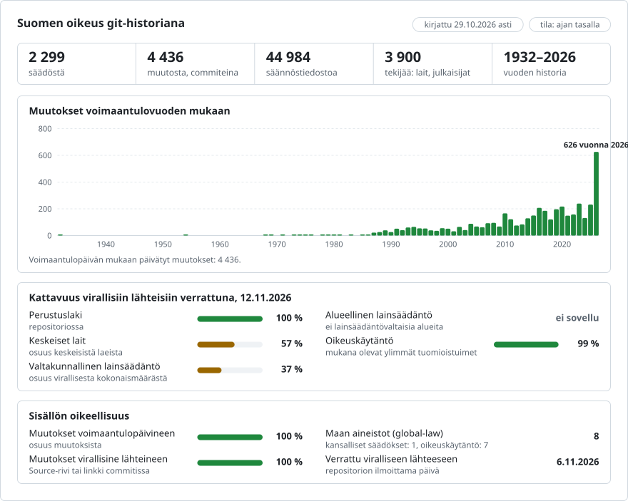

# Suomi: lainsäädännön historia gitissä

**Suomi** · **[Or read it in English](README.en.md)**

<picture>
<source media="(prefers-color-scheme: dark)" srcset="data/fi/effort-dark.svg">

</picture>

Suomen lainsäädäntö git-historiana: yksi tiedosto pykälää kohden, yksi commit kutakin versiota kohden sen voimaantulopäivänä, ja kunkin commitin tekijänä (author) muutoksen tehnyt säädös. `git blame` nimeää jokaisen rivin taustalla olevan säädöksen; `git log` luettelee pykälän jokaisen muutoksen; valitsemalla päivän saa tekstin, joka oli voimassa sinä päivänä.

Osa [lexifina/global-law](https://github.com/lexifina/global-law)-kokonaisuutta, joka on yksi git-historia jokaisen maan oikeudelle: tämä on Suomen kansallinen lainsäädäntö, jonka global-law lukee polusta `finland/national/acts/`.

**Mitä siinä on nyt:** perustuslaki ja 2 290 muuta voimassa olevaa lakia niistä 6 239 laista, jotka Finlex ajantasaistaa, yhteensä 4 436 versiota: 1 749 lakia on muodostettu alkuperäisestä säädöksestä soveltamalla kukin muutossäädös vuorollaan, ja lopputila on tarkistettu Finlexin nykyistä ajantasaista versiota vasten; 542 lakia on täällä vain tuona ajantasaisena versiona ([`CURRENT-TEXT.md`](CURRENT-TEXT.md)); lisäksi, vuosi kerrallaan uusimmasta taaksepäin lisättyinä (tähän mennessä vuodet 2026–1977), 16.11.2026 58 128 Suomen säädöskokoelman säädöstä sellaisina kuin ne on julkaistu, kukin omana tiedostonaan kansiossa `saadoskokoelma/<vuosi>/`, niiden joukossa tuloverolaki 1535/1992, verotusmenettelylaki 1558/1995, ulosottokaari 705/2007 ja kansalaisuuslaki 359/2003 alkuperäisinä, jotka eivät ole edellä mainittujen lakien joukossa. [`acts.csv`](acts.csv) luettelee jokaisen täällä olevan lain kansioineen, [`amendments.csv`](amendments.csv) jokaisen muutossäädöksen päivämäärineen ja [`LEFT-OUT.csv`](LEFT-OUT.csv) ne 3 941 voimassa olevaa lakia, jotka on jätetty pois, kunkin syyn kera.

Kukin laki on kansiossa `laki/<vuosi>/<numero>/`, yksi tiedosto pykälää kohden (`pykala-NNN.md` tai `luku-NN-pykala-NNN.md`, jos pykälät numeroidaan luvuittain): `laki/2019/872/` on työaikalaki (872/2019), ja perustuslaki, Suomen perustuslaki 731/1999, on [`laki/1999/731/`](laki/1999/731/). Ennen 10.11.2026 kukin kansio oli nimetty lain tunnisteen mukaan (`tyoaikalaki`, `perustuslaki`, `sd-<vuosi>-<numero>`), ja sitä aiempi historia ja `tools/finlex.py` käyttävät yhä tätä nimeä; [`data/paths.json`](data/paths.json) yhdistää kunkin tunnisteen sen kansioon.

Teksti on suomenkielinen, kuten Finlex sen julkaisee. Yhtä lailla virallinen ruotsinkielinen teksti ja käännökset eivät ole osa tätä aineistoa.

## Kysymykset git-komentoina

| Kysymys | Komento |
| --- | --- |
| Työaikalain 34 §:n jokainen muutos | `git log -p --word-diff --follow -- laki/2019/872/pykala-034.md` |
| Mikä säädös kirjoitti 34 §:n kunkin rivin? | `git blame laki/2019/872/pykala-034.md` |
| Työaikalain jokainen versio ja kunkin voimaantulopäivä | `git log --format="%h %(trailers:key=In-force,valueonly,separator=) %an" -- laki/2019/872 tyoaikalaki` |
| 34 § sellaisena kuin se oli voimassa 1.1.2022 | `python tools/finlex.py 2022-01-01 tyoaikalaki 34` |

**Gitin ulkopuolella** julkaisemme tämän aineiston myös avoimesti ja maksutta:

- **[Kysy Claudelta Suomen lainsäädännöstä](https://global-law.lexifina.com/v1/try_claude?country=finland)**: avaa Clauden, ja ensimmäinen kysymys on valmiina.
- **[Kysy ChatGPT:ltä](https://global-law.lexifina.com/v1/try_chatgpt?country=finland)**: sama kysymys ChatGPT:ssä.
- **[Hae Suomen lainsäädännöstä sivustollamme](https://lexifina.com/law?country=finland&q=vuosiloma)**: haku sanalla ”vuosiloma”, jokaisen säännöksen teksti ja sen versiot, ilman tiliä.
- **[REST-rajapinta kehittäjille](https://global-law.lexifina.com/v1/search_law?query=vuosiloma&jurisdiction=finland)**: sama haku JSON-muodossa, ilman avainta. Dokumentaatio on [täällä](https://lexifina.com/api/global-law).

Molemmat avustajat lukevat aineistoa maksuttoman Global law -liittimen kautta (MCP, `https://global-law.lexifina.com/mcp`); ensimmäisellä kerralla keskustelu antaa linkin, jolla liitin lisätään. Kysy suomeksi tai englanniksi.

**Aja se helposti itse.** Tarvitset vain gitin ja Pythonin, ja työkalut toimivat omalla koneellasi:

```sh
git clone --depth 1 https://github.com/lexifina/global-law && cd global-law
python3 tools/countries.py add finland/national/acts
python3 tools/law.py show 2026-01-01 finland/national/acts/laki/2019/872/pykala-034.md
```

Kun klooni avataan Claude Codessa, Cursorissa, VS Codessa tai Codexissa, se käynnistää myös paikallisen MCP-palvelimen, jossa on samat työkalut ([MCP.md](https://github.com/lexifina/global-law/blob/main/MCP.md)).

## Päivämäärät

Jokainen commit päivätään kello 12 Helsingin aikaa (Europe/Helsinki) sille päivälle, jona versio tuli voimaan, ja päivä on myös sen `In-force:`-trailerissa:

- muodostetussa laissa voimaantulopäivä, jonka Finlex antaa alkuperäiselle säädökselle ja kullekin muutossäädökselle (sen `amendedBy`-luettelo); jos Finlex ei anna päivää, se otetaan säädöksen omasta voimaantulosäännöksestä, kun se nimeää yhden kiinteän päivän, Finlexin toimituksellisesta huomautuksesta tai asetuksella voimaan saatetun lain osalta tuosta asetuksesta. Määräaikaisessa muutoksessa on `Expires:`, ja sitä seuraavana päivänä saman säädöksen toinen commit palauttaa aiemman tekstin;
- vain ajantasaisena versiona olevassa laissa päivä, jona sen uusin sanamuoto tuli voimaan: voimaantulopäivä, jonka Finlex antaa viimeisimmälle luettelemalleen muutossäädökselle, tai lain oma voimaantulopäivä. Ne 38 lakia, joille Finlex ei anna päivää, on päivätty tekstin hakupäivälle 2026-10-28; `In-force-basis:` kertoo, mikä sääntö päivän antoi;
- git ei pysty tallentamaan vuotta 1970 edeltäviä päiviä, joten 5 aiempaa commitia (vuodesta 1932 alkaen) on päivätty 1970-01-01, ja todellinen päivä on `In-force:`-trailerissa.

Kukin muutos merkitään sen tehneen säädöksen nimiin (`944/2024`, osoite `sd-2024-944@finlex.invalid`). Vain ajantasaisena versiona olevan lain ainoa commit merkitään tekijälle `Finlex (Oikeusministeriö)` tai itse laille, jos Finlex ei luettele sille muutossäädöksiä. Koostamispäivän jälkeen voimaan tulevat muutokset ovat `future`-haarassa, jota ei koskaan yhdistetä.

## Miten se tarkistetaan

- `tools/build.py scan` tallentaa lain vain, jos sen muodostettu lopputila vastaa Finlexin nykyistä ajantasaista versiota jokaisen pykälän osalta [`REPRODUCE.md`](REPRODUCE.md):n ilmoittaman normalisoinnin jälkeen; tarkistuksessa hylätyt lait jätetään pois.
- `tools/check_repo.py` lukee jokaisen lain takaisin gitistä: viimeisen version on vastattava ajantasaista versiota ja ensimmäisen alkuperäistä säädöstä. `tools/check_words.py` vertaa jokaisen viimeisen version kirjaimia ja numeroita ajantasaisen version XML:ään erillisen poimijan avulla.
- Vain ajantasaisena versiona olevan lain tiedostoissa on oltava jokainen ajantasaisen version sana samassa järjestyksessä eikä mitään muuta; tämä luetaan takaisin gitistä (`tools/current_text.py`).
- `tools/test_repo.py` tarkistaa, että blame, päivämäärätyökalu ja yllä olevien kaltaiset komennot toimivat. Tulokset ovat [`REPRODUCE.md`](REPRODUCE.md):ssä.
- [vulnerabilities/](vulnerabilities/): mahdollisia muotoiluvirheitä tässä oikeudessa, global-lawn tunnistimien löytämiä ja käsin tarkistettuja. Ei vielä ajettu.

## Mitä se ei näytä

- **Virallisia aiempia versioita.** Finlex julkaisee kustakin laista vain nykyisen ajantasaisen version: muodostettujen lakien aiemmat versiot on toistettu muutossäädöksistä eikä niitä ole tarkistettu virallista tekstiä vasten, eikä 542:lla vain ajantasaisena versiona olevalla lailla ole täällä aiempia versioita.
- **3 941 voimassa olevaa lakia**: 3 231:llä ei ole tekstiä Finlexin avoimessa datassa, 389 on voimassa olevaksi merkittyjä muutossäädöksiä, eikä loppuja voitu muodostaa ja tarkistaa (katso [`LEFT-OUT.csv`](LEFT-OUT.csv)).
- **Asetuksia, lakeja, jotka eivät enää ole voimassa, oikeuskäytäntöä eikä lakiesityksiä.**
- **Pysyviä commit-tunnisteita.** Uudelleenkoostaminen, joka lisää lakeja, voi päivätä historian uudelleen, joten hashit ja tagit voivat muuttua.

## Lähteet

| Lähde | Laji | Aiemmat versiot | Huomautukset |
| --- | --- | --- | --- |
| [Finlex](https://www.finlex.fi), avoin data (oikeusministeriö), Akoma Ntoso | Virallinen tietokanta: Suomen säädöskokoelman alkuperäiset säädökset ja nykyiset ajantasaiset versiot | ei, vain nykyinen ajantasainen versio | Vain Suomen säädöskokoelma on virallinen; Finlexin ajantasaiset versiot ovat tiedoksi |

Finlexin rajapinnan toiminta opittiin [LawVM](https://github.com/eliask/lawvm)- ja [legalize-dev](https://github.com/legalize-dev)-projekteista; koodia ei kopioitu.

## Lisenssi

Katso [`LICENSE`](LICENSE). Finlexin avoin data on lisensoitu CC BY 4.0 -lisenssillä Finlexin henkilötietojen suojaa koskevin ehdoin; muodostetut aiemmat versiot on johdettu siitä, eikä Finlex julkaise niitä. Historia, commit-viestit, taulukot ja työkalut ovat CC0 1.0 -lisenssin alaisia.

Mikään malli ei kirjoittanut lakitekstiä eikä ollut käytössä koostamisen aikana; koodi kirjoitettiin tekoälymalli Clauden avulla (katso [`REPRODUCE.md`](REPRODUCE.md)).

Tämä on käännös englanninkielisestä versiosta ([README.en.md](README.en.md)); jos ne eroavat, englanninkielinen versio on ratkaiseva.

## Visualisoinnit

- [visualisations/](visualisations/): tästä repositoriosta piirretyt kaaviot. Ei vielä piirretty.

## Lisää

Repositoriosta [lexifina/global-law](https://github.com/lexifina/global-law) (englanniksi):

- [FEATURES.md](https://github.com/lexifina/global-law/blob/main/FEATURES.md): kaikki ominaisuudet ja mitä jokaisen aineiston on tuettava (`git blame`, `law.py`, MCP-työkalut)
- [FAQ.md](https://github.com/lexifina/global-law/blob/main/FAQ.md): kysymyksiä ja vastauksia · [CONTRIBUTING.md](https://github.com/lexifina/global-law/blob/main/CONTRIBUTING.md): muutosten ehdottaminen · [MCP.md](https://github.com/lexifina/global-law/blob/main/MCP.md): MCP-palvelin · [REPRODUCE.md](https://github.com/lexifina/global-law/blob/main/REPRODUCE.md): miten se on koottu · [CHANGELOG.md](https://github.com/lexifina/global-law/blob/main/CHANGELOG.md)
- [FRESHNESS.md](https://github.com/lexifina/global-law/blob/main/FRESHNESS.md): kuinka ajantasainen kukin aineisto on · [Valvonta](https://github.com/lexifina/global-law/tree/main/monitoring): toimivatko päivitykset · [WATCHING.md](https://github.com/lexifina/global-law/blob/main/WATCHING.md): miten kunkin virallisen lähteen muutoksia seurataan
- [performance/](https://github.com/lexifina/global-law/tree/main/performance): kuinka nopeita työkalut ovat, mitattuna
- [visualisations/](https://github.com/lexifina/global-law/tree/main/visualisations): kaaviot ja yhteydet koko maailman oikeudessa
- [Haavoittuvuudet](https://github.com/lexifina/global-law/tree/main/vulnerabilities): virheet säädöksissä sellaisina kuin ne on julkaistu
